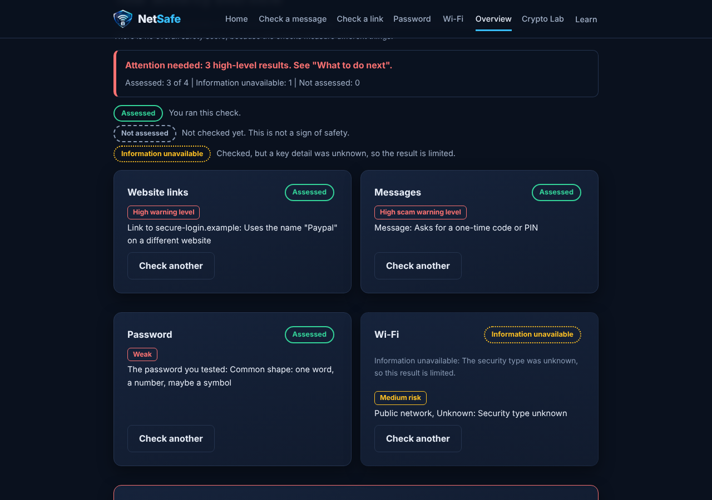
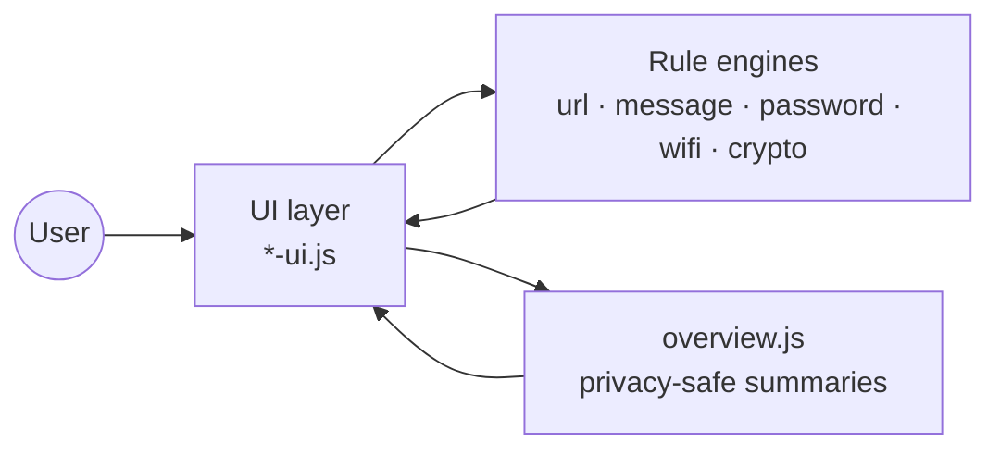

# NetSafe

**Check it before you click, reply or connect.** NetSafe is a privacy-first safety assistant for everyday internet situations. It explains in plain English whether a message, link, password or Wi-Fi network deserves caution, why, and exactly what to do next.



Runs entirely in your browser: nothing you type is stored or sent anywhere, links are never opened, and networks are never scanned. Results come from transparent rules, not AI, and are never a guarantee of safety.

## Why it exists

People get fake bank messages, suspicious links and unfamiliar Wi-Fi every day, and terms like OTP, HTTPS or WPA2 are confusing, so many people guess. NetSafe's goal is to help ordinary people make a safer decision in these four situations: understand the warning signs, and know what to do next, including what to do if they already clicked or replied.

## Features

| Page | What it does |
|---|---|
| **Check a message** | Finds scam wording in an SMS, WhatsApp message or email (OTP, password and card requests, payment demands, threats, fake prizes, urgency, "new number" scams, risky links, sender clues) and highlights each phrase |
| **Check a link** | Analyses a web address as text only: HTTP, IP-address links, `name@host` tricks, look-alike names (punycode, Cyrillic letters, `googIe`/`paypai`/`rnicrosoft` spellings), shorteners, brands on other domains, and more |
| **Password** | Estimates strength from length, common passwords (including `p@ssw0rd` swaps), keyboard and counting patterns, repeats, famous phrases and reuse |
| **Wi-Fi** | Scores a network from your answers (Open, WEP, WPA to WPA3, Enterprise, Enhanced Open, public or private, shared password, login page). Public Wi-Fi is not automatically rated dangerous |
| **Overview** | Everything you checked: Assessed, Not assessed or Information unavailable, a prioritised plan, and a downloadable or printable report. No combined score |
| **Crypto Lab** | Real AES-256-GCM and SHA-256 using the browser's Web Crypto API, a Caesar cipher, and short explainers (HTTPS/TLS, hashing, WPA2 vs WPA3) |
| **Learn** | A glossary, and **How NetSafe decides**: every rule with its points and an example |

## Quick start

NetSafe is plain HTML, CSS and JavaScript. It needs no install, no build step and no backend. Python is **optional**: it only runs a small local web server.

**Option 1: local server (recommended)**

```bash
cd netsafe
python serve.py          # Windows: py serve.py    macOS/Linux: python3 serve.py
```

This opens http://127.0.0.1:8000. `serve.py` uses only the Python standard library. It adds real security headers and serves only the app's files.

**Option 2: open the file directly.** Double-click `index.html`. Tested in Chromium (Chrome, Edge). Every feature works, including the Web Crypto demos.

**Option 3: any static host.** Upload the folder to GitHub Pages or Netlify. HTTPS hosting keeps the Web Crypto demos working.

### Troubleshooting

| What you see | Cause | Fix |
|---|---|---|
| Banner "NetSafe's tools are not running", buttons do nothing | Scripts were blocked or a folder is missing | Keep `css/`, `js/` and `assets/` next to `index.html`, then use `python serve.py` |
| Same banner only with `python serve.py` on Windows (old copies of NetSafe) | Windows registry served `.js` as `text/plain`; with `nosniff` the browser refused every script | Fixed: `serve.py` now sets content types itself. Use this version |
| AES and SHA-256 demos say "not available" | Web Crypto works only on `https://`, `localhost`/`127.0.0.1` or a local file. A phone opening `http://<your-PC-IP>` does not qualify | Use `serve.py` on the same device, open the file directly, or host on HTTPS |
| Console shows "Refused to execute inline script" with VS Code Live Server | Live Server injects a reload script; NetSafe's security policy blocks it on purpose | Harmless; NetSafe still works. Or use `python serve.py` |

## How it works



- **Engines are pure functions** (no DOM, network or storage) that run unchanged in the browser and under Node tests.
- **Rules are data.** Each engine has one readable rule table; the Learn page is generated from the same tables.
- **The overview only receives rule-written advice**, never what you typed (tests check this for every input type).

Details, a worked rule example and the decision log: [docs/ARCHITECTURE.md](docs/ARCHITECTURE.md).

## Project structure

```
index.html            single page with eight views (Home, Message, Link, Password, Wi-Fi, Overview, Crypto Lab, Learn)
serve.py              optional local server with security headers (Python, standard library)
css/style.css
js/
  url.js  message.js  password.js  rules.js  crypto.js     rule engines (pure)
  overview.js                                              summaries, statuses, plan, report
  *-ui.js  nav.js  content.js                              rendering, page navigation, text
tests/
  *.test.js                                                unit tests (Node)
  test_serve.py                                            server tests (Python unittest)
  browser/browser_tests.py                                 real-browser tests (Playwright)
docs/                 architecture, security and privacy, limitations, demo script
```

## Testing

```bash
node tests/run-all.js                                  # unit tests (Node 20+, no packages)
python -m unittest discover -s tests -p "test_*.py"    # server tests (Python standard library)
pip install playwright && playwright install chromium
python tests/browser/browser_tests.py                  # real-browser tests, about 2 minutes (--only nav,overview for a subset)
```

Last full run (Node 22, Python 3.13, Chromium 157): **280** unit checks, **15** server tests, **183** browser checks, all passed. Firefox and Safari were not run.

Covered: every rule engine and its scoring; that documented rule examples really trigger their rules; look-alike domains and their false positives; privacy of the overview and report; script and HTML payloads in every input stay inert; no network or storage use; the security policy; correct content types even with a broken system MIME table; page navigation; real button clicks and keyboard use on every page; accessibility on all pages (text contrast, accessible names, keyboard focus, 44 px targets); layout from 320 to 1280 px. Browser tests run on Chromium only.

## Privacy and security

No backend, accounts, analytics or third-party code. A strict Content-Security-Policy blocks everything except the app's own files, so the page cannot send data out. All text is rendered with `textContent`. The AES demo uses only Web Crypto (PBKDF2 and AES-GCM). Full details and threat model: [docs/SECURITY_AND_PRIVACY.md](docs/SECURITY_AND_PRIVACY.md).

## Limitations

Rule-based and English-focused (plus a few Roman Urdu phrases); links are judged by text only (no reputation, certificate or redirect checks); the password checker has no breach database; the Wi-Fi check uses your answers and cannot detect fake hotspots; the crypto demo is a learning tool. Full list: [docs/LIMITATIONS.md](docs/LIMITATIONS.md).

## Roadmap

| Idea | Effort | Notes |
|---|---|---|
| **Local Wi-Fi agent in Python**: read the real security type and network name from the OS (`netsh wlan` / `nmcli` / `airport`) and feed the Wi-Fi page automatically | Medium | Matches the original proposal's "automatic detection" goal; the agent stays on `127.0.0.1` |
| **Flask + SQLite backend** for opt-in reporting of scam numbers and links, shared across users | Large | Needs a consent design; keep password checks in the browser; cannot run on GitHub Pages |
| Full Public Suffix List and a larger brand and look-alike list (Pakistani banks, telcos, couriers) | Small | Improves link accuracy |
| Urdu and Roman Urdu message rules, Urdu interface | Medium | Message rules are data, so this is mostly adding entries and tests |
| Opt-in breach check (k-anonymity range API) | Small | Needs explicit consent and a narrow network exception in the policy |
| Installable offline app (PWA) and "share to NetSafe" from WhatsApp | Medium | Needs a service worker, which the current audit forbids on purpose |
| Light theme and settings | Small | |
| Single-file build (`python tools/bundle.py`) for easy sharing | Small | Optional |

## Context

Built as a Computer Networks project (wireless security, encryption and hashing, HTTPS/TLS, authentication, phishing and man-in-the-middle attacks) and for SafeSpace Hacks. Educational only: not a penetration-testing tool, a professional security audit, or legal or financial advice.
