# NetSafe

**Check it before you click, reply or connect.**

NetSafe is a privacy-first internet safety assistant for everyday people. You paste a message or a link, try a made-up password, or describe a Wi-Fi network. NetSafe then tells you in plain English how risky it looks, why, and exactly what to do next, including what to do if you already clicked, replied or paid.

Everything runs in your browser. Nothing you type is stored or sent anywhere, links are never opened, and networks are never scanned. Results come from transparent rules, not AI, and NetSafe never calls anything "safe".

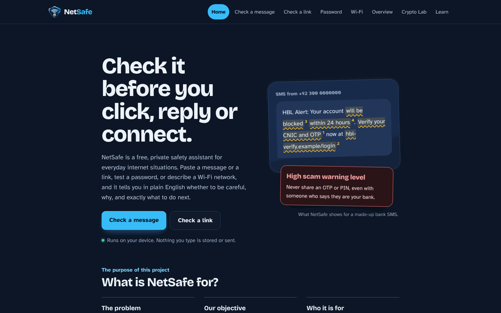

**Contents:** [Why it exists](#why-it-exists) · [Use cases](#use-cases) · [Features and screenshots](#features-and-screenshots) · [What makes it different](#what-makes-it-different) · [Quick start](#quick-start) · [How it works](#how-it-works) · [Testing](#testing) · [Privacy and security](#privacy-and-security) · [Limitations](#limitations) · [Future improvements](#future-improvements)

---

## Why it exists

Every day people receive fake bank messages, suspicious links and requests for money from accounts that look like a friend's. They also have to connect to unknown Wi-Fi. Terms like OTP, HTTPS or WPA3 are confusing, so many people guess, and one wrong guess can empty a bank account or lose a WhatsApp account.

Pakistan's FIA received more than 250,000 complaints in 2025 about hacked WhatsApp, Facebook and Instagram accounts and fake profiles used to ask for money. NetSafe's goal is to help ordinary people pause, recognise the warning signs, and take the right next step.

## Use cases

| Situation | What NetSafe does |
|---|---|
| An SMS "from your bank" says your account will be blocked and asks for an OTP | Rates it High, highlights each warning phrase, and puts the most important step first: never share an OTP |
| A friend or relative suddenly asks for money on WhatsApp ("I'm at the hospital, send 15,000 to this JazzCash number, I can't talk, I'll pay you back") | Recognises the hacked-account pattern and tells you to call them on their usual number before sending anything |
| Someone asks you to buy Google Play or Apple gift cards and send the codes | Always High: gift card codes are untraceable cash |
| "Please vote for my niece in this contest" with a link, or "someone sent you a code by mistake, send it back" | Flags the WhatsApp account-theft tricks and explains what happens if you enter the code |
| "Hi mum, this is my new number, my phone fell in water" | Warns that this is how "new number" scams begin, and to check on the old number |
| A link that looks like your bank, Google or a government office | Shows which part of the address decides where it really goes, and flags look-alike names (`g00gle`, `paypa1`, Cyrillic letters) and brand names on other domains |
| A link in an email whose text says `www.google.com` but which really goes somewhere else | Reads the real address from the copied email and warns about the mismatch |
| Fake e-challan, BISP, tax refund or parcel messages | Flags official-sounding names that come with a payment, link or threat |
| Choosing a new password | Explains why `Summer2024!` is weak (a word plus a year) and suggests a passphrase |
| Connecting to airport, café or hotel Wi-Fi | Rates the risk from what you know about the network and says what is reasonable to do on it |
| Learning how encryption works (students, teachers) | The Crypto Lab runs real AES-GCM and SHA-256 and shows tampering being detected |

## Features and screenshots

### Check a message

Finds scam wording in an SMS, WhatsApp message or email and highlights each phrase. It covers:
- OTP, password and card requests, and payment demands
- Threats of violence or kidnapping, and blackmail
- "Sent by mistake" refunds, task jobs and investment offers
- Fake BISP, e-challan, PTA and FBR notices
- Remote-access apps and WhatsApp code theft
- Hacked-friend money requests: repay promises, sudden emergencies, "can't talk", payment to another person's wallet
- Gift card codes, "vote for my child", "is this you?" links, and "Hi mum, new number"
- Risky links, and links that show one site but go to another

Every finding says what was noticed, why it matters, what could happen and what to do.

| A fake bank alert | A message from a friend's hacked account |
|---|---|
| 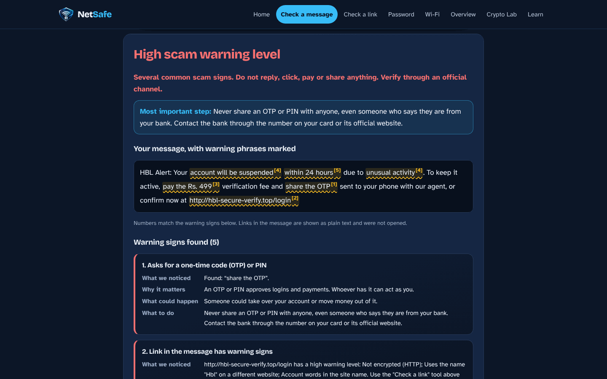 | 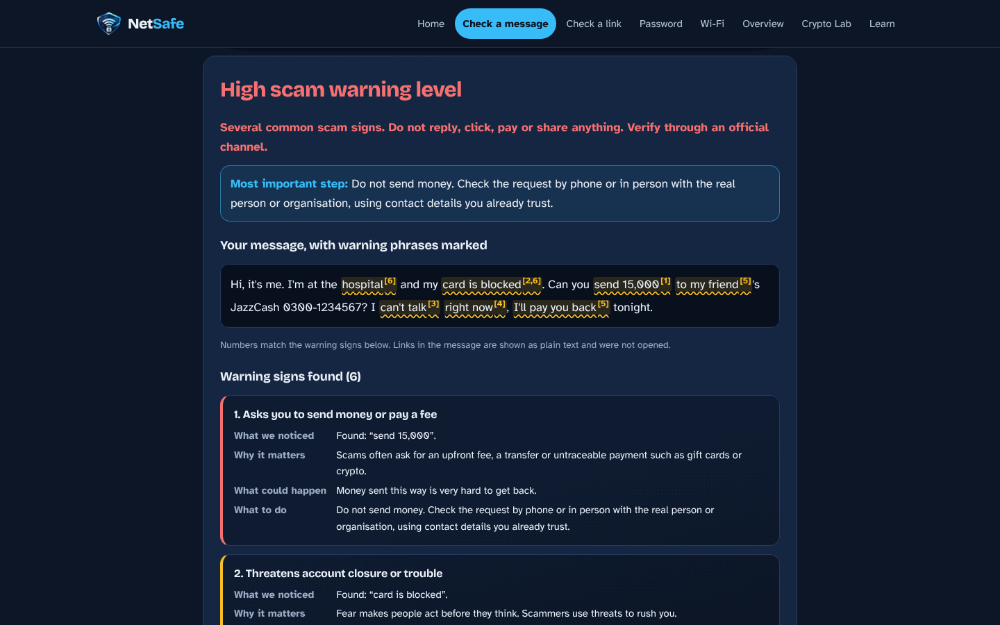 |

### Check a link

Analyses a web address as text only, and never opens it. It checks for:
- HTTP links and IP-address links
- `name@host` tricks
- Look-alike names (punycode, Cyrillic letters, `goog1e`, `rnicrosoft`) and brand names on other domains, including Pakistani banks, wallets and couriers
- Shorteners, free hosting pages and fake government names
- **Hidden links:** when a link copied from an email shows one website but goes to another, NetSafe puts the real address in the box and warns

| Hidden address found in a copied link | The result for the real address |
|---|---|
| 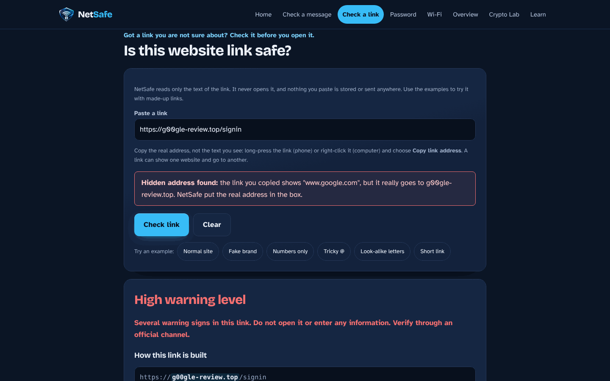 | 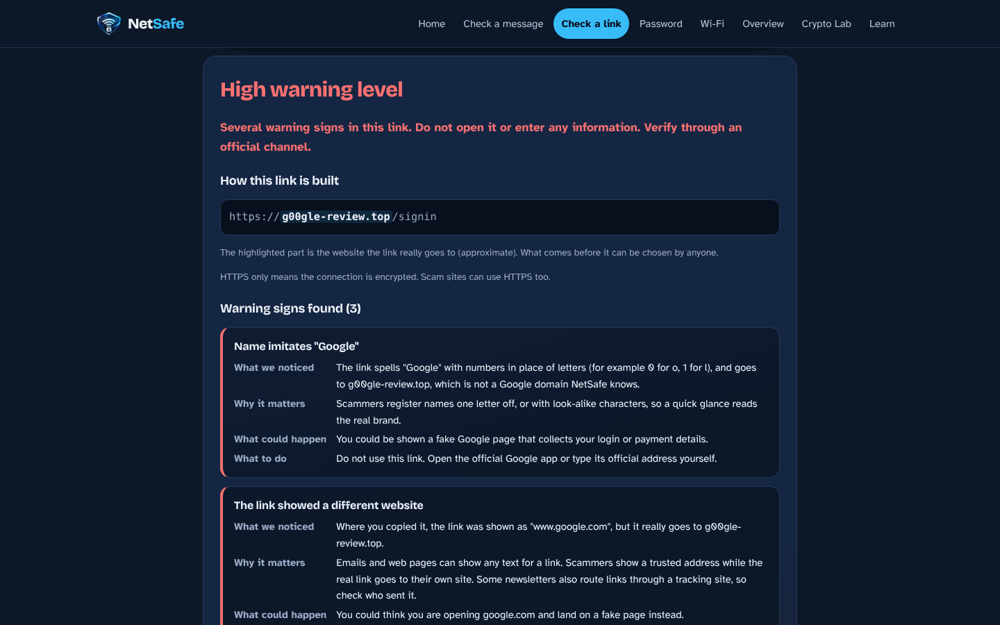 |

### Password strength

Estimates strength on your device from:
- Length
- Common passwords, including `p@ssw0rd`-style swaps
- Phone, CNIC and birth-date passwords
- Keyboard and counting patterns, repeats and famous phrases
- Reuse (from the box you tick)

### Wi-Fi risk

Scores a network from your answers (Open, WEP, WPA to WPA3, Enterprise, public or private, shared password, login page). It also flags "free" hotspot names and factory router names. Public Wi-Fi is not automatically rated dangerous.

| Password strength | Wi-Fi risk |
|---|---|
| 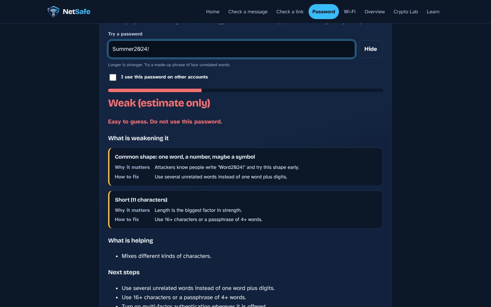 | 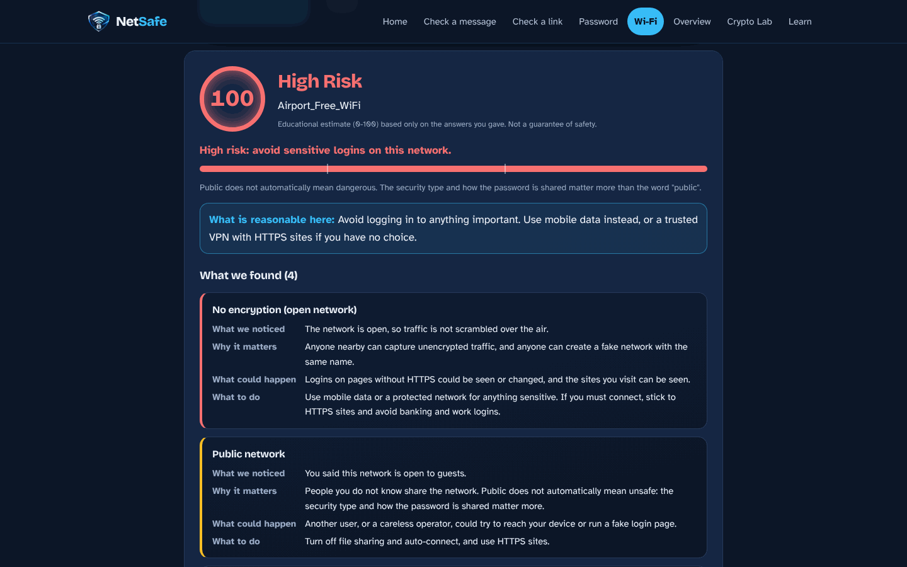 |

### Crypto Lab, Overview and Learn

- **Crypto Lab:**
  - Real AES-256-GCM (with PBKDF2) and SHA-256 using the browser's Web Crypto API.
  - Change one character of the encrypted text and decryption is refused.
  - A Caesar cipher with brute force.
  - Short explainers on HTTPS/TLS, hashing and WPA2 vs WPA3.
- **Overview:** everything you checked, marked Assessed, Not assessed or Information unavailable. It gives a prioritised plan and a downloadable or printable report. There is no combined score, and it never keeps what you typed.
- **Learn:** a glossary, and *How NetSafe decides*, which lists every rule with its points and an example.

| Crypto Lab | Overview | Learn |
|---|---|---|
| 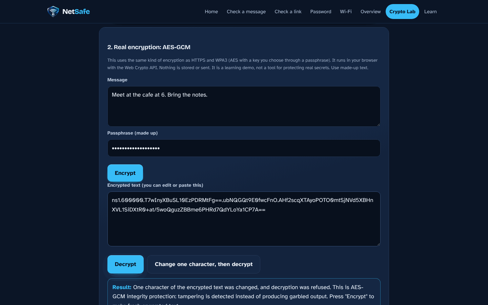 | 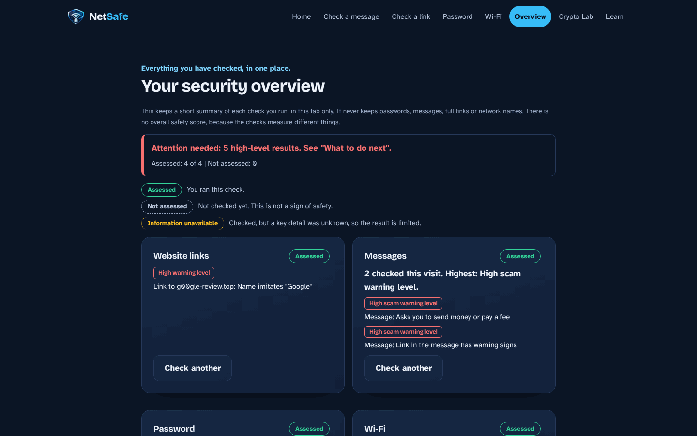 | 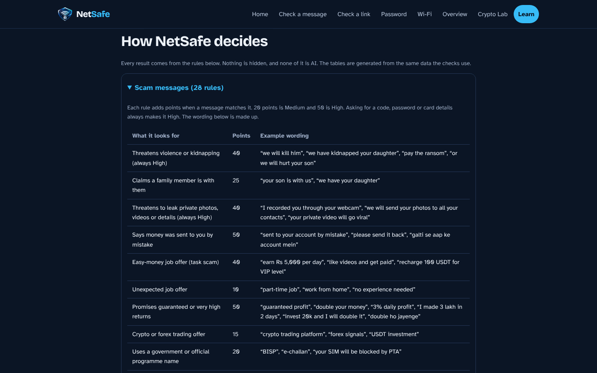 |

### On a phone

The layout works from 320 px wide upwards.

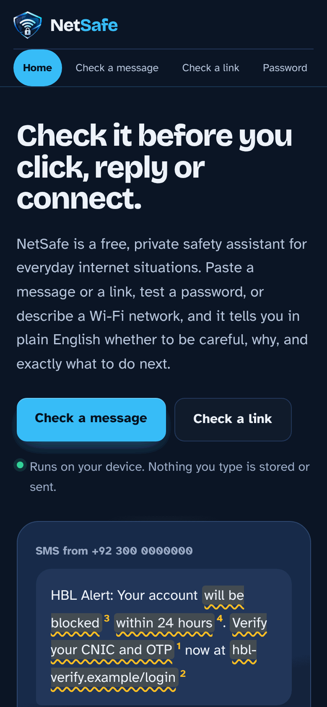

## What makes it different

- **Private by design.** There is no server, account, analytics or third-party code. You can safely paste a private message, because it never leaves your device.
- **Covers four everyday situations in one place:** message, link, password and Wi-Fi, plus an overview, a report and learning pages.
- **Explains instead of only judging.** Every warning shows the exact phrase, why it matters, and what to do, including steps for people who already clicked, replied or paid.
- **Transparent.** No AI and no black box: every rule and its points are listed on the Learn page.
- **Honest.** It never says "safe". It says "no strong warning signs", and lists what it did not check.
- **Local.** It knows Pakistani scams (JazzCash, Easypaisa, BISP, e-challan, local banks, CNIC passwords) and some Roman Urdu wording, and points to FIA cybercrime (1991).
- **Educational.** The Crypto Lab shows real encryption and tamper detection, not a simulation.

## Quick start

NetSafe is plain HTML, CSS and JavaScript. It needs no install, no build step and no backend. Python is **optional**: it only runs a small local web server.

**Option 1: local server (recommended)**

```bash
cd netsafe
python serve.py          # Windows: py serve.py    macOS/Linux: python3 serve.py
```

This opens http://127.0.0.1:8000. `serve.py` uses only the Python standard library. It adds security headers and serves only the app's files.

**Option 2: open the file directly.** Double-click `index.html`. Tested in Chromium (Chrome, Edge). Every feature works, including the Web Crypto demos.

**Option 3: any static host (Netlify, GitHub Pages).**
- No build step is needed, and HTTPS hosting keeps the Web Crypto demos working.
- For Netlify: leave *Build command* empty and set *Publish directory* to `.`. The included `netlify.toml` publishes the folder as it is and sends the security headers.

### Troubleshooting

| What you see | Cause | Fix |
|---|---|---|
| Banner "NetSafe's tools are not running", buttons do nothing | Scripts were blocked or a folder is missing | Keep `css/`, `js/` and `assets/` next to `index.html`, then use `python serve.py` |
| The banner lists `js/...: could not be loaded` on a hosted site | That file is not in the deploy, or its name differs in letter case | Redeploy the folder that directly contains `index.html` and all of `js/` |
| Banner with no details; console says a script from another domain was blocked | The host's asset optimization moved the scripts | Use the included `netlify.toml` (`skip_processing = true`), or turn asset optimization off |
| AES and SHA-256 demos say "not available" | Web Crypto works only on `https://`, `localhost`/`127.0.0.1` or a local file | Use `serve.py` on the same device, open the file directly, or host on HTTPS |
| "Refused to execute inline script" with VS Code Live Server | Live Server injects a reload script, which the security policy blocks on purpose | Harmless, or use `python serve.py` |

## How it works

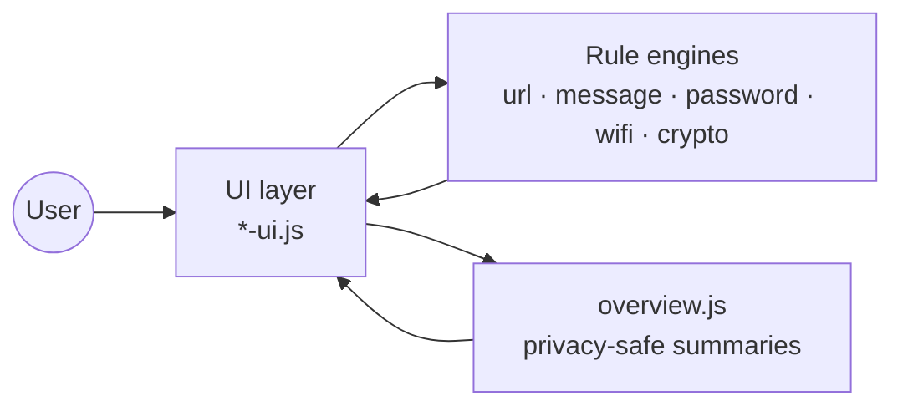

- **The engines are pure functions:** no DOM, network or storage. They run unchanged in the browser and under Node tests.
- **Rules are data.** Each engine has one readable rule table, and the Learn page is generated from the same tables.
- **Scores are additive points with clear levels.** Some rules always mean High: asking for an OTP, a password or card details, gift card codes, threats, and code theft.
- **The Overview only receives advice written by the rules**, never what you typed. Tests check this for every input type.

Details, a worked rule example and the decision log: [docs/ARCHITECTURE.md](docs/ARCHITECTURE.md).

### Project structure

```
index.html            single page with eight views (Home, Message, Link, Password, Wi-Fi, Overview, Crypto Lab, Learn)
netlify.toml          static-host settings (publish folder, no processing, security headers)
serve.py              optional local server with security headers (Python, standard library)
css/style.css
assets/               logo, icons, self-hosted fonts
js/
  boot.js                                                  start-up diagnostics for the warning banner (loads first)
  url.js  message.js  password.js  rules.js  crypto.js     rule engines (pure)
  overview.js                                              summaries, statuses, plan, report
  *-ui.js  nav.js  content.js                              rendering, page navigation, text
tests/
  *.test.js                                                unit and scenario tests (Node)
  test_serve.py                                            server tests (Python unittest)
  browser/browser_tests.py                                 real-browser tests (Playwright)
docs/                 architecture, security and privacy, limitations, demo script, screenshots
```

## Testing

```bash
node tests/run-all.js                                  # unit and scenario tests (Node 20+, no packages)
python -m unittest discover -s tests -p "test_*.py"    # server tests (Python standard library)
pip install playwright && playwright install chromium
python tests/browser/browser_tests.py                  # real-browser tests, about 2 minutes
```

Last full run (Node 22, Python 3.13, Chromium 157), all passed:
- **692** unit and scenario checks in 12 suites. These include a 246-scenario real-world sweep and 60 hacked-friend scam and everyday-message scenarios.
- **15** server tests.
- **199** browser checks.

The tests cover:
- Every rule engine and its scoring, and that each documented rule example really triggers its rule.
- Look-alike domains and hidden links, and their false positives.
- That everyday messages stay Low.
- Privacy of the overview and report, and that script or HTML pasted into any input stays inert.
- That nothing uses the network or storage, and the security policy.
- Real clicks and keyboard use on every page.
- Accessibility: contrast, accessible names, focus, 44 px targets.
- Layout from 320 to 1280 px.

## Privacy and security

- No backend, accounts, analytics or third-party code.
- The fonts (Atkinson Hyperlegible and Bricolage Grotesque, SIL Open Font License) are stored in `assets/fonts`.
- A strict Content-Security-Policy allows only the app's own files, so the page cannot send data out.
- All text is rendered with `textContent`, never `innerHTML`.
- Links pasted from an email are read with an inert `DOMParser`: no scripts run and no images load.
- The AES demo uses only Web Crypto (PBKDF2 and AES-GCM).

Full details and threat model: [docs/SECURITY_AND_PRIVACY.md](docs/SECURITY_AND_PRIVACY.md).

## Limitations

NetSafe helps people pause and check. It does not replace judgement, a bank or a security professional.

**General**
- **Rules, not AI.** It recognises known scam wording and link tricks. A scam written in a new way can get Low, and a genuine message can sometimes get a warning.
- **Low is not "safe".** Every page says so.
- **No online lookups, by design.** It does not check website reputation, blocklists, certificates, redirects, domain age or data breaches, because that would mean sending what you typed to a server.
- **Languages:** the interface is in English, and the message rules cover English and some Roman Urdu. Urdu script and other languages are not covered.

**Messages**
- **No sender check.** It cannot tell that an account was hacked: the message comes from the real number, name and photo. It only recognises the wording these scams use.
- **Openers pass.** A message like "Hi, are you free?" has nothing to detect yet.
- **A real friend asking for money** with the same words gets the same warning. The advice (call them first) is right either way.
- **Text only.** It cannot read images, voice notes or attachments.

**Links**
- **Text only.** A hacked real website, or a brand-new scam site that copies no known name, is not detected.
- **Look-alikes:** detection compares names against a built-in list of brands, banks, wallets, couriers and government offices.
- **Hidden links** are found only when the copy carries the real address, as copying from an email or web page in a computer browser does. SMS and chat apps on phones copy plain text only.

**Passwords**
- **An estimate, not a cracking time.** There is no breach database, and it knows only a built-in list of common passwords.

**Wi-Fi**
- **Your answers only.** It cannot scan, detect a fake "evil twin" hotspot, or verify the security type you chose.

**Crypto Lab and Overview**
- **The Crypto Lab is a learning demo.** Do not use it for real secrets.
- **Results are lost on reload,** because they are kept in memory only.

**Testing**
- **Chromium only.** Browser tests ran on Chromium. Firefox, Safari, real phones and screen readers were not tested.

The full list, with numbers for every rule set, is in [docs/LIMITATIONS.md](docs/LIMITATIONS.md).

## Future improvements

| Improvement | Why | Effort |
|---|---|---|
| **Browser extension or "share to NetSafe" from WhatsApp/SMS** (installable PWA) | Check a message or the real link address without copying and pasting, including on phones | Medium |
| **Urdu script and more Roman Urdu rules**, Urdu interface | Many scam messages in Pakistan are in Urdu | Medium |
| **Opt-in reputation check** (for example Google Safe Browsing, through a small backend that hides the API key) | Catch known scam sites and hacked real sites that text rules miss. Off by default, with clear consent | Medium |
| **Opt-in breach check** for passwords (k-anonymity range API: only 5 characters of a hash are sent) | Tell people if a password appeared in a data breach | Small |
| **Community scam reports** (Flask or similar backend, moderated) | Share new scam numbers, wallet accounts and links between users | Large |
| **Local Wi-Fi helper** that reads the real security type and network name from the operating system | Removes guesswork from the Wi-Fi check | Medium |
| **Screenshot and QR-code checking** (text read on the device) | Many scams arrive as images or QR codes | Medium |
| **Full Public Suffix List and a larger brand list** | Fewer missed look-alikes and fewer false alarms | Small |
| **Voice-clone and video-call scam guidance** | AI voice scams are growing | Small |
| **Light theme, larger text mode, saved settings** | Accessibility and comfort for older users | Small |
| **Firefox, Safari, phone and screen-reader testing** | Wider support | Small |

## Context

NetSafe was built as a Computer Networks project, covering wireless security, encryption and hashing, HTTPS/TLS, authentication, phishing and man-in-the-middle attacks, and for **SafeSpace Hacks**. It is educational only. It is not a penetration-testing tool, a professional security audit, or legal or financial advice. If you have lost money or an account, contact your bank and report it (in Pakistan: FIA cybercrime helpline 1991).
