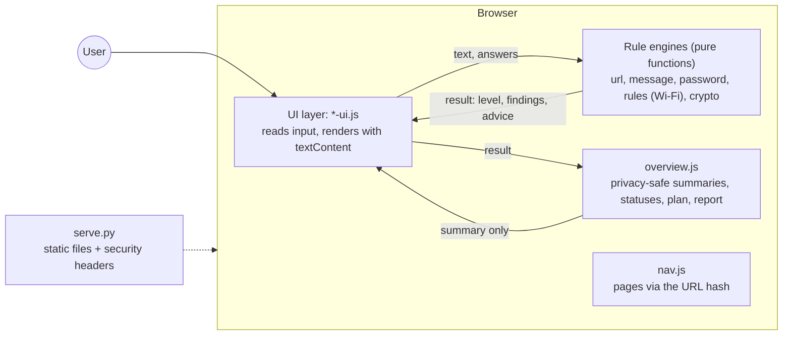

# Architecture

NetSafe is a static web app. The rule engines are pure JavaScript functions that run in the user's browser; the UI only collects input and renders results. Python is used for the local server and the browser tests.



## Principles

| Principle | How it shows up |
|---|---|
| Engines are pure | No DOM, no network, no storage in `url.js`, `message.js`, `password.js`, `rules.js`, `crypto.js`, `overview.js`. They run unchanged under Node, which is how they are unit-tested. |
| UI only renders | `*-ui.js` read inputs and write results with `textContent`. `innerHTML`, `eval` and friends are banned by `tests/audit.test.js`. |
| Rules are data | Each engine's rules live in one readable table. The Learn page renders those same tables, so documentation cannot drift from behaviour. |
| Privacy by construction | The overview never receives raw input: adapters copy only rule-written text (see below). |
| Honest uncertainty | Every result lists what was not checked; "not assessed" is never treated as safe; there is no combined score. |

## A rule, concretely

```js
// js/message.js
{ id: 'otp', pts: 35, floor: 'High',
  examples: ['share your OTP', 'verify your OTP'],            // shown on the Learn page, proven by tests
  re: [req(ASK, 'otp|one[- ]time (?:pass(?:word|code)|code|pin)|verification code|...')],
  title: 'Asks for a one-time code (OTP) or PIN',
  why: '...', could: '...', action: '...' }
```

Every finding carries the same five parts: what was noticed, why it matters, what could happen, what to do now, and (per result) what to do if you already responded.

**Scoring.** Points from matched rules are added up (capped at 100) and compared with thresholds (Low, Medium, High). A rule can set a *floor* (asking for an OTP is always High) and a protocol can set a *ceiling* (an unknown Wi-Fi security type is held at Medium). Wi-Fi uses a points table in `CONFIG` (`js/rules.js`); links use `URL_CONFIG`; messages use `MSG_RULES` and `MSG_CONFIG`.

**Adding a rule** (message example): add an entry to `MSG_RULES` with `examples`, run `npm test` (a test checks each example matches its own rule), and the Learn page shows it automatically.

## The privacy boundary: overview.js

`overview.js` keeps one summary per assessment, in memory, for the current tab. Adapters (`ovFromLink`, `ovFromMessage`, `ovFromPassword`, `ovFromWifi`) copy only titles and advice written by the rules. They never copy the matched phrases, the message, the sender, the password, the link path or the network name, and tests check this for each input type. The report is generated from the same summaries, so it cannot leak either.

## Pages

The eight pages are `<section data-view="...">` blocks. `nav.js` shows the one named in the URL hash (`#wifi`), updates the title and focus, and supports Back/Forward. Pages are views of one file (not eight files) so the overview survives navigation without any storage. If a script fails to load, `#boot` stays visible with instructions instead of the page failing silently.

## Where Python is used, and why the engines are not in Python

- `serve.py`: local server on `127.0.0.1` that sends security headers (CSP taken from `index.html`, `frame-ancestors`, `nosniff`, ...) and serves only the app's files.
- `tests/test_serve.py` and `tests/browser/browser_tests.py`: server tests and the real-browser test suite (Playwright).

The rules run in JavaScript on purpose. Messages and passwords are private, and running the rules in the browser means they never leave the device. It also lets the app be hosted as plain static files (for example GitHub Pages) and the same code be tested under Node.

**Why not a Flask backend?** A backend would receive users' messages and passwords, need hosting, and could not run on GitHub Pages. It becomes worthwhile when there is something a browser cannot do alone: a shared database of reported scam numbers and links, a reporting feature, or rule updates without redeploying. If added, keep password checking in the browser and make sending text to the server an explicit opt-in. See the roadmap in the README.

## Testing

| Layer | Command | What it proves |
|---|---|---|
| Unit (Node) | `npm test` | Every rule engine, scoring, privacy of summaries and report, documented examples trigger their rules, demo scenarios, static audit of the code and HTML |
| Server (Python) | `python -m unittest discover -s tests -p "test_*.py"` | Headers, allowlist, path traversal, methods |
| Browser (Playwright) | `python tests/browser/browser_tests.py` | Every page and tool, navigation, XSS payloads stay inert, no network or storage use, CSP behaviour, accessibility (contrast, names, focus, target size) on all pages, layout at four widths, report and print |

## Decision log

- **No AI.** Rules are transparent and testable. The UI says so.
- **No overall score.** A link, a password and a network measure different things.
- **Links are never opened.** Analysis is text-only; reputation and certificate checks would need the network.
- **Pages as views.** Keeps the overview in memory across pages with no storage.
- **Strict CSP.** `default-src 'none'`: only the app's own files load and nothing can be sent out. `file:` is allowed only so the page also works when opened from disk.
